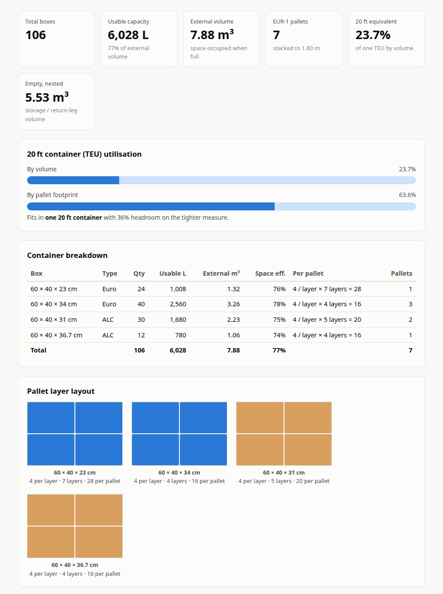

# Eurobox Logistics Calculator

A single-page calculator for turning Eurobox (Euronorm stacking container) quantities into logistics figures:

- **Total volume** in m³ and litres (external dimensions)
- **Euro pallet loads** (EUR-1 or EUR-6 half pallet) at a selectable max stack height, with per-layer layout diagrams
- **20 ft container (TEU) utilisation** by volume and by pallet floor positions
- **A4 PDF report** via the "Save as PDF" button (browser print-to-PDF, print stylesheet)
- **3D models** of the same units — view in the browser, download the GLB, or load a size straight into the calculation

Box sizes are grouped by footprint in collapsible sections; each height variant has an illustrated tile (box icon with height arrow) and a quantity field.

**Live:** https://danielrosehill.github.io/eurobox-calculator/ · also served at https://blog.danielrosehill.com/tools/eurobox-calculator/

## Box sizes

Standard footprints included: 600 × 400 (heights 12–42 cm incl. 17.5, 23, 31 cm), 400 × 300, 300 × 200, 800 × 600 — plus custom dimensions.

## 3D models

The "3D models" section renders the GLBs from
[storage-box-3d-models](https://github.com/danielrosehill/storage-box-3d-models) with Google's
`<model-viewer>`. Each card offers a GLB download and, for the container sizes, an "Add to
calculation" button — it fills the matching catalogue tile when the calculator already lists that
size, and a custom row when it does not.

Two deliberate choices:

- **Assets are loaded from absolute URLs** (`https://blog.danielrosehill.com/models/storage-boxes/`)
  rather than relative paths, so this one `index.html` works identically from GitHub Pages, from the
  blog copy, and inside the Android WebView without a build step to rewrite paths. The blog sends
  `Access-Control-Allow-Origin: *` on `/models/`, which `<model-viewer>` requires cross-origin.
- **`<model-viewer>` and the GLBs load on demand**, not on page load. The script (~1 MB) is fetched
  from a CDN the first time someone presses "View in 3D", and each GLB only when its own card is
  opened. The preview JPEG stands in until then. Consequence: with no network the section shows the
  posters and the button reports "3D unavailable offline".

The model set and the calculator's height catalogue are **different grids** — of the eight models
only the 600 × 400 × 230 is a size the calculator already lists. That is why "Add to calculation"
falls back to a custom row rather than assuming a tile exists.

## Assumptions

- External box dimensions; boxes are stacked in aligned grid layers with no overhang
- Single-SKU pallets (box types are not mixed on one pallet) — counts are conservative planning estimates, not a packing optimisation
- EUR-1 pallet: 1200 × 800 × 144 mm; 11 per 20 ft container floor
- 20 ft container internal volume: 33.2 m³

## Stack

Plain HTML/CSS/JS, no build step, no dependencies. Hosted on GitHub Pages.
