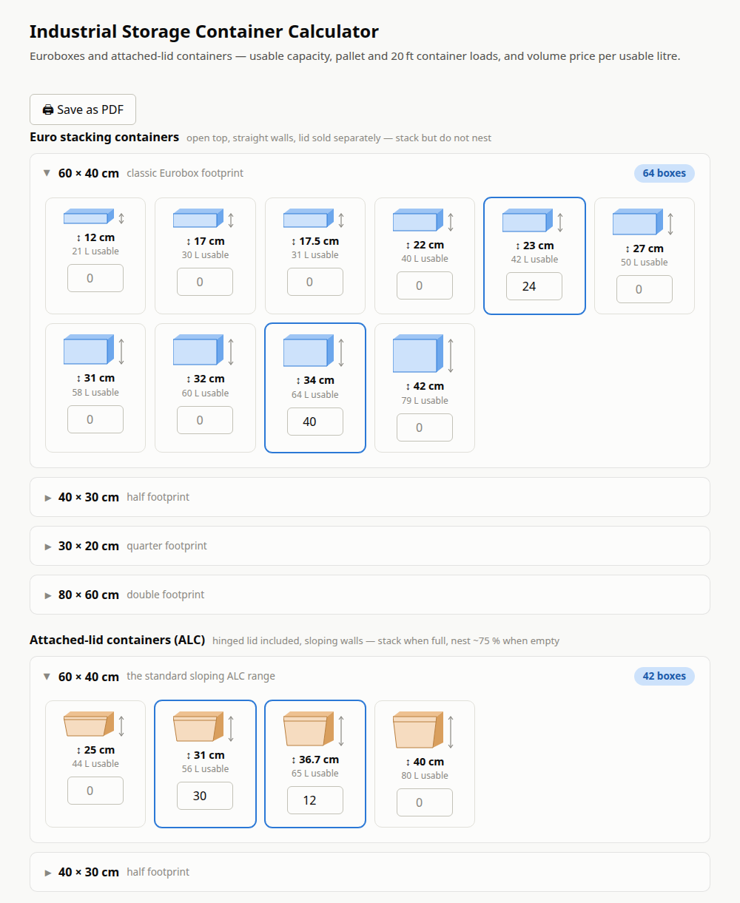
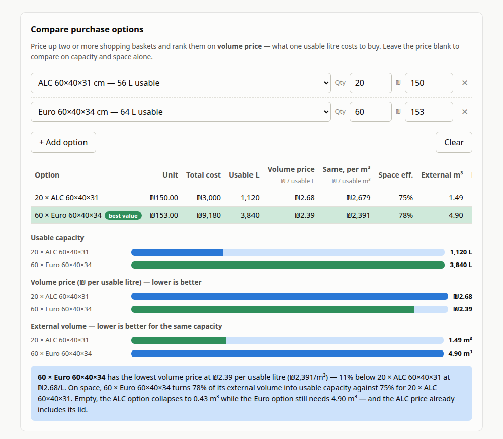

# Industrial Storage Container Calculator

A single-page calculator for two families of industrial storage container — **Euro
stacking containers** (Euroboxes) and **attached-lid containers** (ALCs) — that
answers both halves of a purchasing question:

- **How much will it hold, and how much space will it take?** Usable capacity,
  external volume, Euro pallet loads with per-layer diagrams, 20 ft container (TEU)
  utilisation, and the volume of the same boxes stored empty and nested.
- **Which purchase is better value?** Price up two or more baskets and rank them on
  **volume price** — what one usable litre costs to buy.

**Live:** https://danielrosehill.github.io/eurobox-calculator/ · also served at
https://blog.danielrosehill.com/tools/eurobox-calculator/

## Volume price

*Purchase price ÷ usable capacity*, quoted per usable litre with the same figure per
m³ alongside. Lower is better.

There is no industry-standard term for this — freight quotes per m³, supermarkets
call it unit pricing, container makers quote per box — so the name is this tool's
own. Litres are the primary scale because every container on the market lands
between roughly 0.10 and 10 per litre, which reads better than four-digit per-m³
figures.

The metric is deliberately built on **usable** capacity, not external L × W × H.
Comparing on external volume flatters a tapered ALC against a straight-walled
Eurobox of the same nominal size, which is exactly the error the tool exists to
prevent. Worked example, at Israeli retail prices:

| Basket | Usable | Total | Volume price |
|---|---|---|---|
| 20 × ALC 60 × 40 × 31 @ ₪150 | 1,120 L | ₪3,000 | **₪2.68 / L** |
| 60 × Euro 60 × 40 × 34 @ ₪153 | 3,840 L | ₪9,180 | **₪2.39 / L** |

The Eurobox buys volume 11 % more cheaply. The ALC's case is elsewhere: its price
includes a lid, and those 20 boxes collapse to 0.43 m³ when empty against the
Eurobox's 4.90 m³.

## Are ALCs Euroboxes?

No — which is why the tool is no longer called the Eurobox calculator. They share
the 600 × 400 and 400 × 300 footprints and palletise identically, but they are a
distinct product: sloping walls, an integral hinged lid, their own height grid, and
they nest ~75 % when empty where a straight-walled Eurobox does not nest at all.
The catalogue keeps them as separate families throughout, colour-coded blue for
Euro and amber for ALC down to the pallet layer diagrams.

The repository keeps its old name so the GitHub Pages URL and the blog copy do not
break.

## What it computes

- **Usable capacity** in litres, and its ratio to external volume ("space efficiency")
- **External volume** in m³ — the space the boxes occupy when full
- **Empty, nested volume** — the storage and return-leg figure, where ALCs win
- **Euro pallet loads** (EUR-1 or EUR-6 half pallet) at a selectable max stack
  height, with per-layer layout diagrams
- **20 ft container (TEU) utilisation** by volume and by pallet floor positions
- **A4 PDF report** via "Save as PDF" (browser print-to-PDF, print stylesheet)
- **3D models** of the same units — view in the browser, download the GLB, or load a
  size straight into the calculation

Quantities, prices and settings persist in `localStorage`, so a supplier's price
list survives a reload.

## Catalogue

| Family | Footprints | Heights |
|---|---|---|
| Euro stacking | 600 × 400 | 120, 170, 175, 220, 230, 270, 310, 320, 340, 420 |
| | 400 × 300 | 120, 170, 220, 270, 320 |
| | 300 × 200 | 120, 170, 220 |
| | 800 × 600 | 220, 320, 420 |
| ALC | 600 × 400 | 250, 310, 367, 400 |
| | 400 × 300 | 222, 264, 306 |

Plus custom dimensions, which pick their capacity estimate from a straight-walled or
tapered wall style. Custom sizes also appear in the comparison dropdown, so a size
the catalogue does not list can still be priced against one that it does.

**Every capacity figure, its source and its confidence level is in
[`docs/container-reference-data.md`](docs/container-reference-data.md)** — including
which numbers are geometrically derived, which are vendor nominal figures, and the
one known outlier. Catalogue capacities are typical and vary by manufacturer; check
the supplier's own internal dimensions before committing to a large order.

## 3D models

The "3D models" section renders the GLBs from
[storage-box-3d-models](https://github.com/danielrosehill/storage-box-3d-models) with
Google's `<model-viewer>`. Each card offers a GLB download and, for the container
sizes, an "Add to calculation" button — it fills the matching catalogue tile when the
calculator already lists that size and family, and a custom row when it does not.

Two deliberate choices:

- **Assets are loaded from absolute URLs** (`https://blog.danielrosehill.com/models/storage-boxes/`)
  rather than relative paths, so this one `index.html` works identically from GitHub
  Pages, from the blog copy, and inside the Android WebView without a build step to
  rewrite paths. The blog sends `Access-Control-Allow-Origin: *` on `/models/`, which
  `<model-viewer>` requires cross-origin.
- **`<model-viewer>` and the GLBs load on demand**, not on page load. The script
  (~1 MB) is fetched from a CDN the first time someone presses "View in 3D", and each
  GLB only when its own card is opened. The preview JPEG stands in until then.
  Consequence: with no network the section shows the posters and the button reports
  "3D unavailable offline".

The model set and the calculator's height catalogue are **different grids** — only
the 600 × 400 × 230 Eurobox is a size the calculator already lists. That is why "Add
to calculation" falls back to a custom row rather than assuming a tile exists.

## Assumptions

- Single-SKU pallets (box types are not mixed on one pallet) — counts are
  conservative planning estimates, not a packing optimisation
- Boxes are stacked in aligned grid layers with no overhang
- EUR-1 pallet: 1200 × 800 × 144 mm; 11 per 20 ft container floor
- 20 ft container internal volume: 33.2 m³
- ALCs nest to 75 % of their height when empty; Euro stacking containers do not nest
- Volume price excludes freight, duty, and separately bought lids

## Stack

Plain HTML/CSS/JS, no build step, no dependencies. Hosted on GitHub Pages.
